# DFIR Case Study: Insider Threat and Unauthorised Data Exfiltration


This case study shows how I would investigate a suspected insider taking confidential data from a business-critical workstation. It covers identification, collection, preservation, analysis and documentation, with an unbroken chain of custody throughout.

This is a **methodology and reasoning exercise**, not an incident report. The scenario, the organisation and the illustrative timeline are fictional.

<p align="center">
  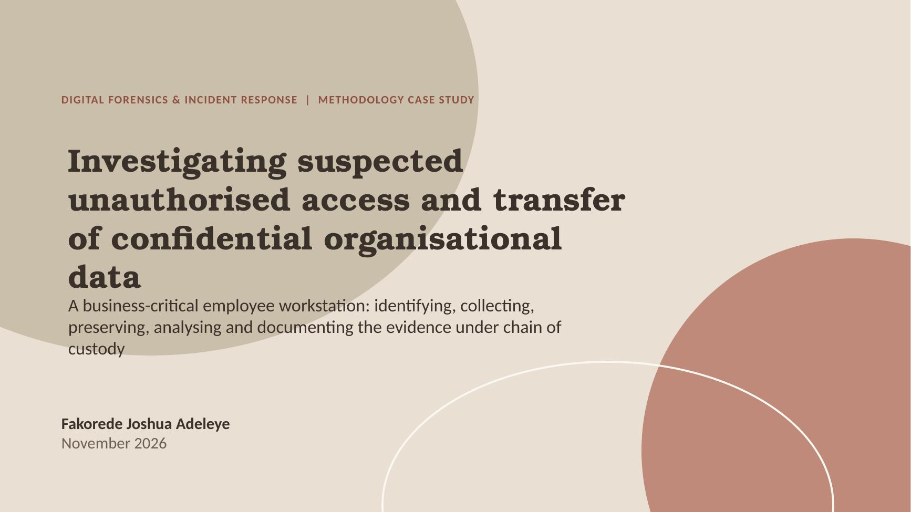
</p>

| Start here | |
|---|---|
| 📑 **The deck** | [PDF](presentation/DFIR_Insider_Threat_Investigation_Methodology.pdf) (no PowerPoint needed) · [PPTX](presentation/DFIR_Insider_Threat_Investigation_Methodology.pptx) (10 slides with the full speaker script) |
| 📖 **Read it as an article** | [Written walkthrough](docs/walkthrough.md): every slide with its narration and examiner's notes |
| 🔎 **Technical reference** | [Artefact reference](docs/artefact-reference.md): where each artefact lives, what it supports, and what it can't tell you |
| 🧰 **Use it** | [Chain of custody form](templates/chain-of-custody-form.md) · [Forensic report template](templates/forensic-report-template.md) · [Collection and hunting queries](queries/) |

---

## The scenario

> A business-critical employee workstation is suspected of being used to access and transfer confidential organisational data without authorisation. How would you identify, collect, preserve, analyse, and document the digital evidence while maintaining chain of custody?

## Why this case study

Most insider-threat write-ups either stop at "pull the logs" or jump straight to "the employee did it", and neither holds up under scrutiny. This one is built on two principles:

- **Never claim more than the evidence supports.** Every indicator is phrased as *helps establish* or *supports*, never *proves*, unless the result is binary, such as a SHA-256 match. Attributing the act to a person is left to the disciplinary or legal process to decide on the full record. A forensic examiner doesn't assert it from logs alone.
- **Test competing explanations, not just the obvious one.** Alongside "deliberate insider", the method tests whether:
  - the account was compromised or remotely controlled
  - someone else used an unlocked session or shared credentials
  - this is a set-up to implicate the employee
  - there's a legitimate business explanation

  All of these are tested before any conclusion is drawn.

## Methodology

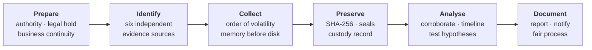

The investigation follows the digital evidence lifecycle in **ISO/IEC 27037** (identification, collection, acquisition, preservation) and **ISO/IEC 27042** (analysis and interpretation). Collection is ordered by volatility, following **RFC 3227** and **NIST SP 800-86**.

| Stage | What it covers |
|---|---|
| **Prepare** | Authority and scope; immediate preservation of logs, CCTV and the mailbox; keeping the business running |
| **Identify** | Six independent evidence sources: workstation, identity/logon, email, business applications, network/endpoint, physical |
| **Collect** | Strict order of volatility, including the on-site case, the remote case (EDR live response) and the machine that can't go offline |
| **Preserve** | Physical and digital chain of custody, with a worked custody record and hash verification at every transfer |
| **Analyse** | Cross-source corroboration (no single Windows artefact proves a file transfer), an illustrative timeline, and a hypothesis-testing matrix |
| **Document** | A report that separates fact from opinion and includes findings in the employee's favour. Regulatory notification goes through Legal and Compliance, not the examiner's own judgment. |

### What the investigation must establish

| 01 Confidential | 02 Accessed | 03 Transferred | 04 Unauthorised | 05 Attributable |
|---|---|---|---|---|
| Classified by the data owner and policy | Opened from this workstation | Left the organisation's control by a known route | Beyond the employee's role and signed policies | The employee was at the keyboard, not just their account |

### The illustrative case in brief

A mail gateway alert fires at **22:36** for a file sent to a personal address. Working back from that alert, the preserved records show:

1. an after-hours badge entry
2. a console unlock
3. 214 customer records viewed against a daily norm of 35
4. an Excel export
5. a password-protected archive
6. an email to personal Gmail
7. the sent item deleted
8. a badge-out

Each step is tied to at least one independent record.

**Conclusion so far:** the evidence supports that confidential data was exported and sent externally *from the assigned workstation and account*. **Attribution, authorisation and intent stay open** until the employee has been heard, the set-up and shared-login hypotheses are tested, and earlier transfers are ruled in or out. ([Full timeline and hypothesis matrix](docs/walkthrough.md#8-analyse-what-the-records-show))

## Slides

| | |
|---|---|
|  | 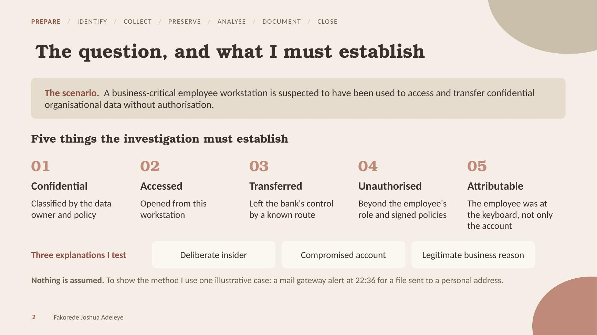 |
| 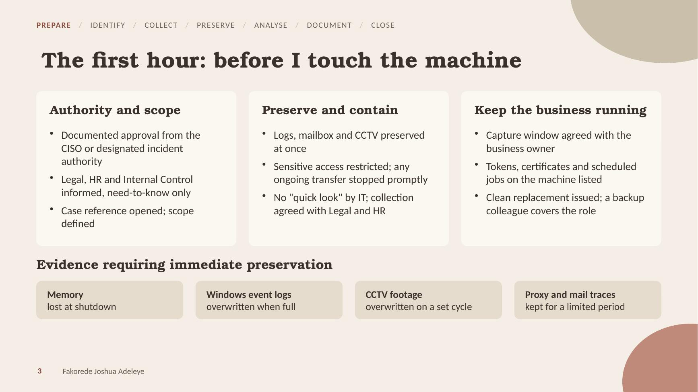 | 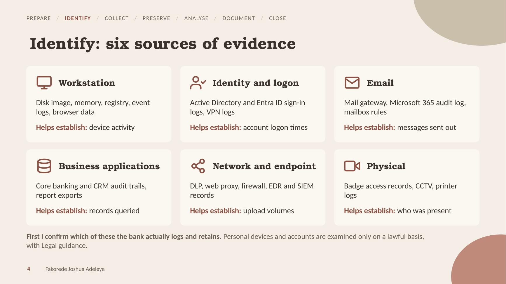 |
| 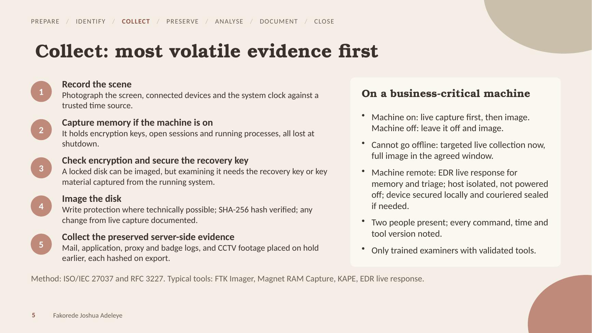 | 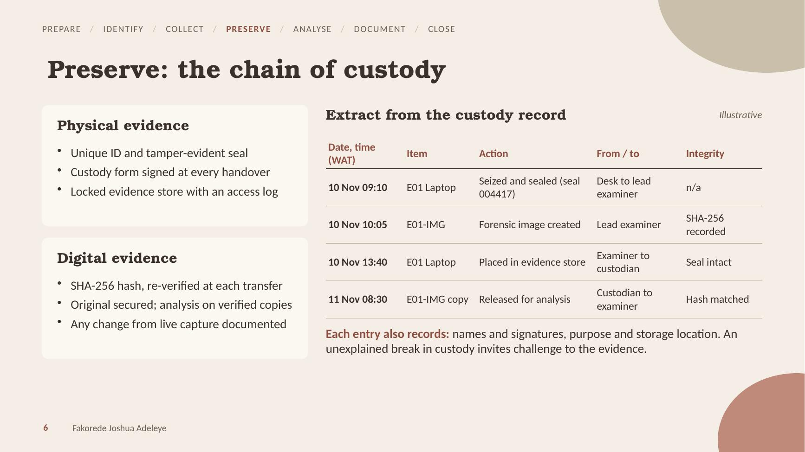 |
| 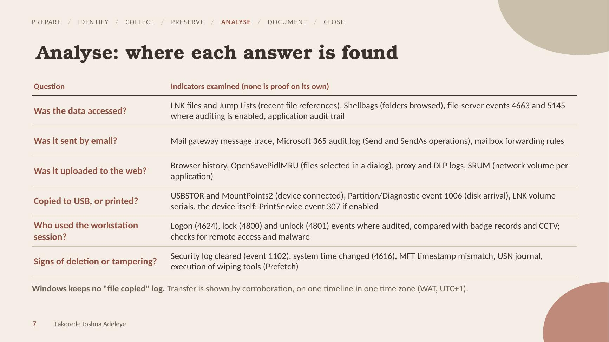 | 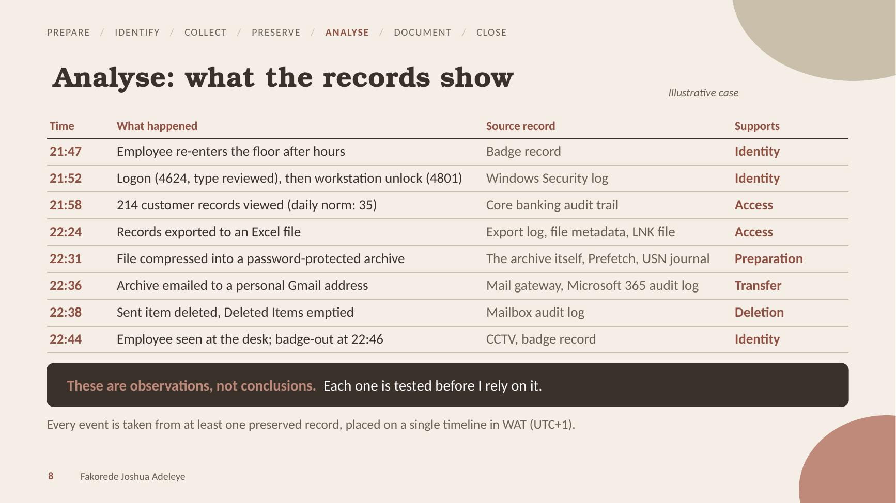 |
| 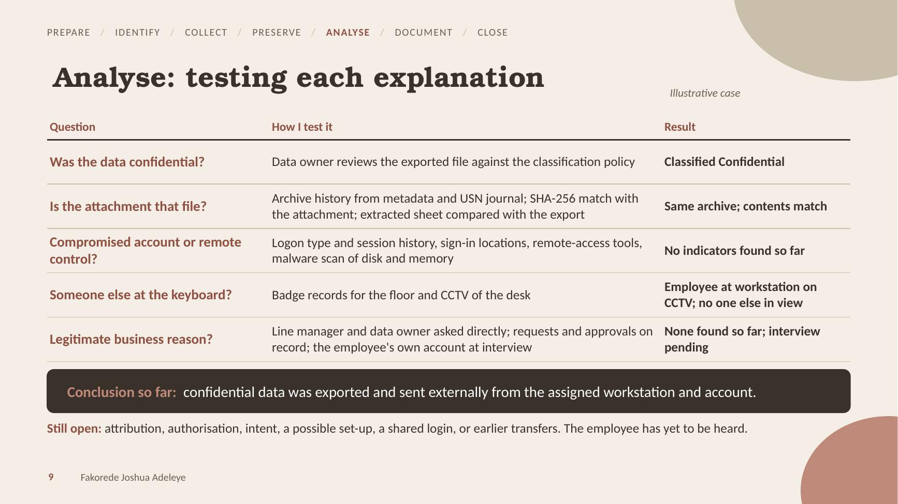 | 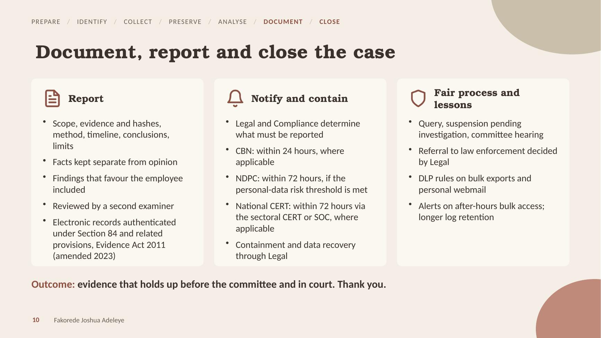 |

## Repository contents

```
├── presentation/
│   ├── DFIR_Insider_Threat_Investigation_Methodology.pptx   editable source: 10 slides + speaker script
│   └── DFIR_Insider_Threat_Investigation_Methodology.pdf    static export
├── docs/
│   ├── walkthrough.md          the full case study in prose, slide by slide
│   └── artefact-reference.md   artefact locations, what they support, and their limits
├── templates/
│   ├── chain-of-custody-form.md
│   └── forensic-report-template.md
├── queries/
│   ├── Export-M365Evidence.ps1         read-only M365 export with SHA-256 hashing and a collection log
│   └── defender-advanced-hunting.kql   Defender XDR queries that rebuild the illustrative timeline
└── assets/                     slide images
```

### About the queries

The [`queries/`](queries/) folder turns the method into practice:

- **`Export-M365Evidence.ps1`** exports unified audit log mailbox activity, message trace and (optionally) Entra ID sign-ins for one user and time window. It uses read-only cmdlets only. Each CSV is hashed with SHA-256 on export, and every command run is written to a timestamped collection log, ready for the chain of custody record.
- **`defender-advanced-hunting.kql`** contains one query per step of the timeline and per alternative hypothesis: outbound mail, matching the attachment hash to a file on the device, archive creation, logon type, remote-access tools, USB mounts, mailbox deletions, and earlier transfers.

Both are examples to adapt to your environment. Validate them in a test tenant, and run them only with documented authority.

## Artefacts and techniques covered

- **Collection and integrity:** memory acquisition and order of volatility; BitLocker handling and recovery-key dependency; forensic imaging and SHA-256 verification
- **File access:** LNK files and Jump Lists; Shellbags; OpenSavePidlMRU
- **Network and removable media:** SRUM; USBSTOR, MountedDevices and MountPoints2
- **NTFS and execution:** USN journal; MFT `$STANDARD_INFORMATION` vs `$FILE_NAME` timestamp analysis; Prefetch
- **Windows event correlation:**
  - logon and session: 4624 (logon type), 4800/4801
  - file access: 4663, 5145
  - tampering: 4616, 1102
  - devices and printing: Partition/Diagnostic 1006, PrintService 307
- **Microsoft 365:** unified audit log (`Send`/`SendAs` vs mailbox deletion and inbox-rule operations); message trace; Defender XDR advanced hunting
- **Remote and live response:** EDR-based collection on a host that can't go offline

## Regulatory grounding

The documentation stage uses a real regulatory framework rather than generic "notify the regulator" language. The case is set in a Nigerian financial institution:

| Area | Instrument | What it means here |
|---|---|---|
| Admissibility | **Evidence Act 2011 (as amended 2023), Section 84** | Electronic records must be authenticated, with a certificate under s.84(4) |
| Financial-sector reporting | **CBN Risk-Based Cybersecurity Framework** | Report to the CBN within 24 hours, where applicable |
| Personal-data breach | **Nigeria Data Protection Act 2023, s.40** | Notify the NDPC within 72 hours if the risk threshold is met |
| Cyber incident reporting | **Cybercrimes (Prohibition, Prevention, etc.) (Amendment) Act 2024** | Report to the national CERT within 72 hours via the sectoral CERT or SOC, where applicable |
| Employment | Fair, documented HR process | Runs *in parallel with* the forensic investigation, not instead of it |

The structure carries over to other jurisdictions. For example, GDPR Art. 33 also sets a 72-hour notification window. In every case, deciding *whether* to notify belongs to Legal and Compliance, not the examiner.

## Scope

This covers the **forensic evidence lifecycle**, which is one part of the wider incident response lifecycle (preparation → detection and analysis → containment → eradication → recovery → lessons learned). Containment is covered only where it protects evidence. Eradication and recovery are out of scope, because this is a suspected insider matter with no confirmed attacker intrusion to remediate.

## Skills demonstrated

- Structuring an investigation around testable hypotheses rather than a predetermined conclusion
- Windows and Microsoft 365 forensic artefact analysis, with correct terminology and stated limitations
- Chain-of-custody design and hash-based integrity verification
- Turning method into practice: read-only, hashed and logged evidence collection, plus Defender XDR hunting
- Placing forensic method within the wider incident response lifecycle and the regulatory context
- Explaining technical findings to a non-technical panel clearly and without overclaiming

## Disclaimer

The scenario, organisation, people and data are fictional. This repository is for education and portfolio purposes and isn't legal advice. Regulatory obligations depend on the facts and the jurisdiction. The scripts and queries are examples: test them before operational use, and run them only with proper authority.

## Author

**Fakorede Joshua Adeleye**, Information Security
[LinkedIn](https://www.linkedin.com/in/joshua-f-4ba031190) · [GitHub](https://github.com/Joshua1w)

## Licence

© 2026 Fakorede Joshua Adeleye. Licensed under [Creative Commons Attribution 4.0 International (CC BY 4.0)](LICENSE). You may share and adapt this material, including the templates and queries, if you give appropriate credit.
