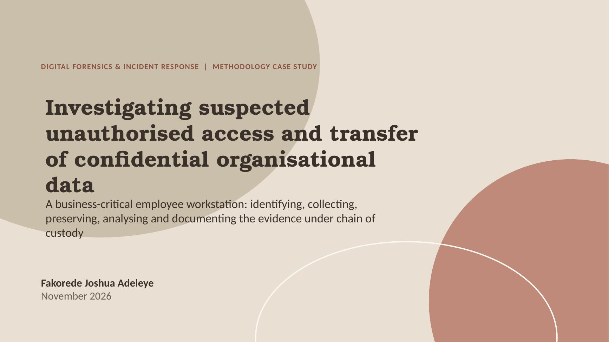
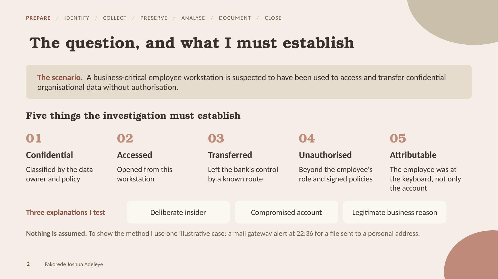
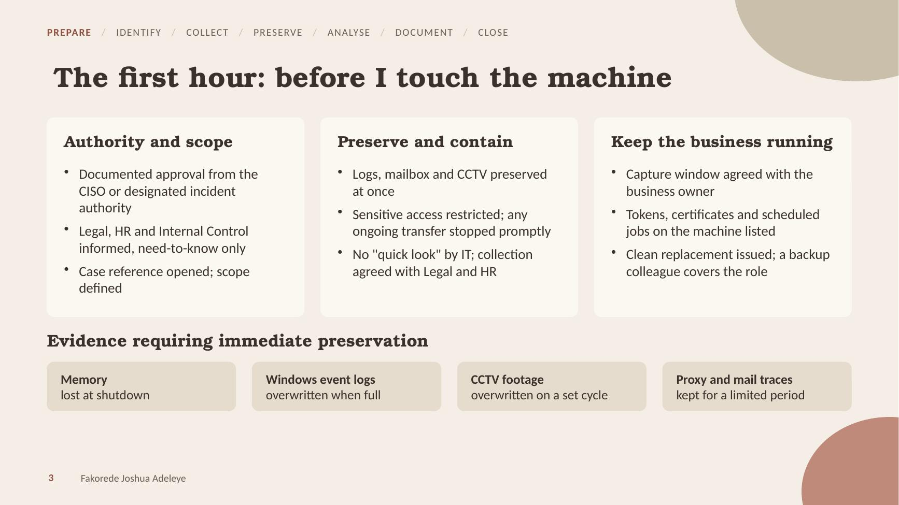
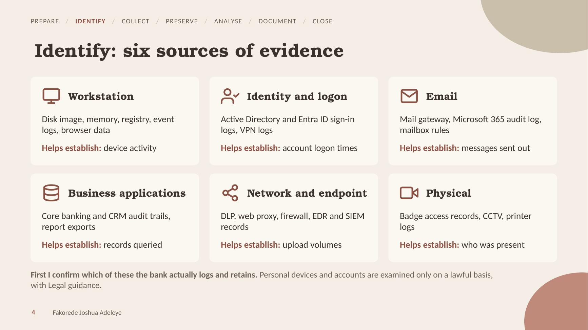
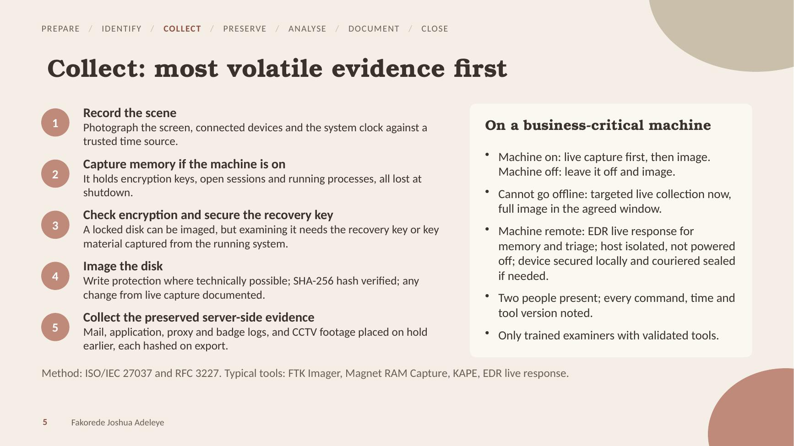
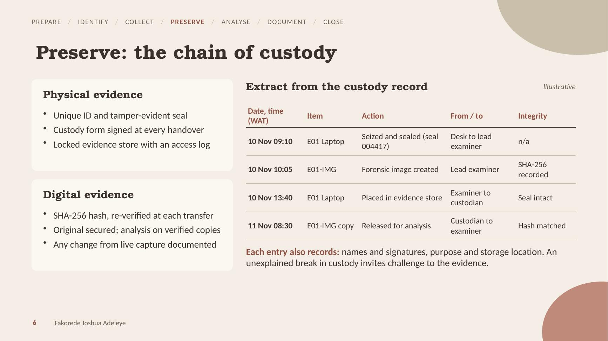
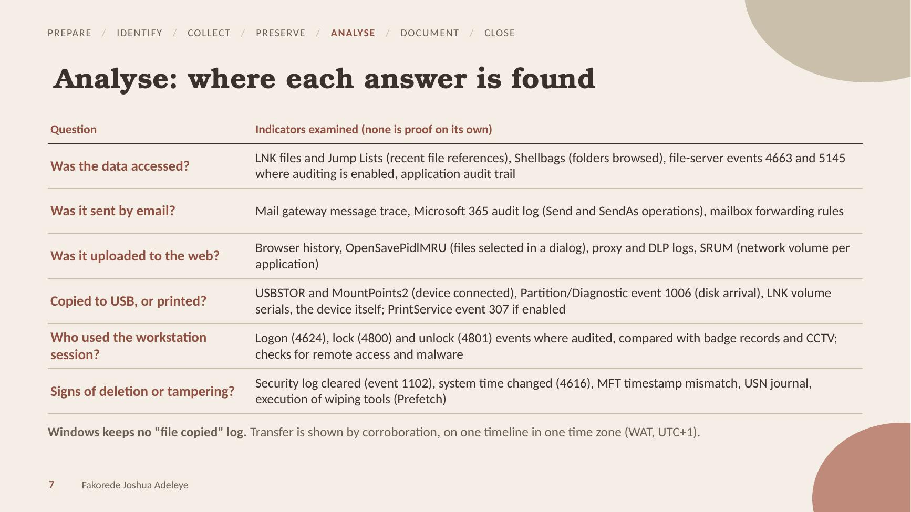
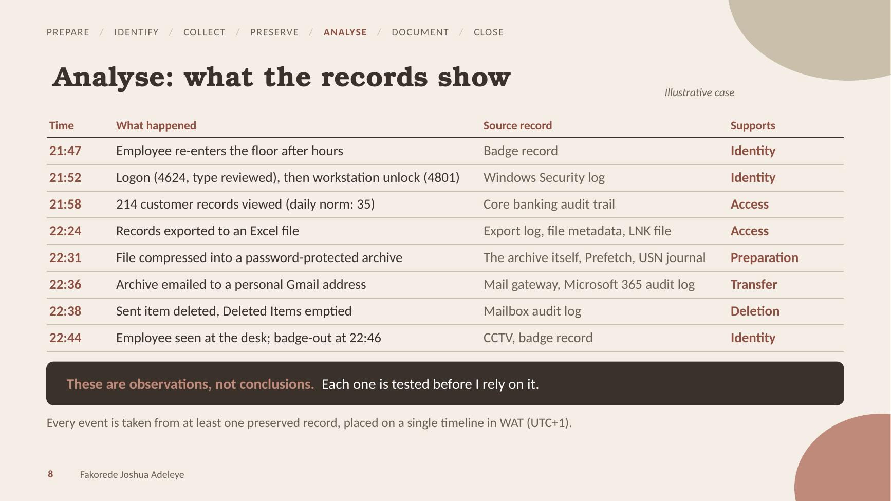
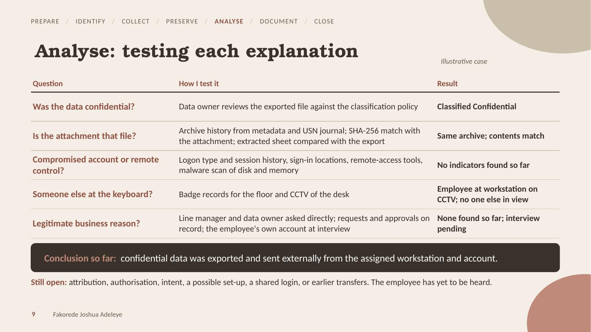
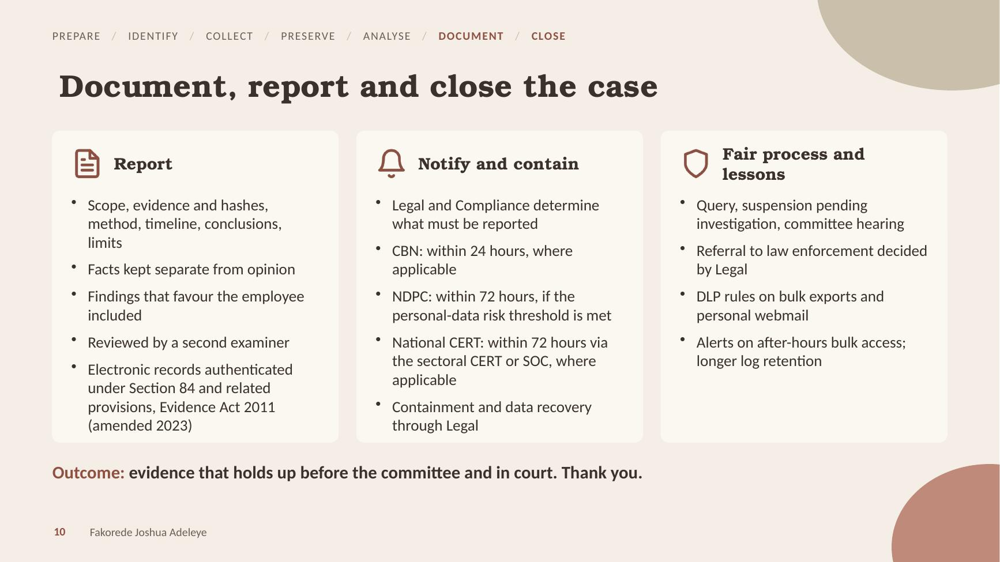

# Written walkthrough

The full case study in prose: every slide, followed by the reasoning I give when presenting it. Read this if you don't want to open the deck. The narration comes from the speaker script in the [`.pptx`](../presentation/DFIR_Insider_Threat_Investigation_Methodology.pptx). The **Examiner's notes** add technical detail that doesn't fit on a slide.

> The scenario, organisation, people and timeline are fictional. They exist to show the method.

**Contents**

1. [Title](#1-title)
2. [The question, and what I must establish](#2-the-question-and-what-i-must-establish)
3. [The first hour: before I touch the machine](#3-the-first-hour-before-i-touch-the-machine)
4. [Identify: six sources of evidence](#4-identify-six-sources-of-evidence)
5. [Collect: most volatile evidence first](#5-collect-most-volatile-evidence-first)
6. [Preserve: the chain of custody](#6-preserve-the-chain-of-custody)
7. [Analyse: where each answer is found](#7-analyse-where-each-answer-is-found)
8. [Analyse: what the records show](#8-analyse-what-the-records-show)
9. [Analyse: testing each explanation](#9-analyse-testing-each-explanation)
10. [Document, report and close the case](#10-document-report-and-close-the-case)

---

## 1. Title

This case study looks at a business-critical employee workstation that is suspected of being used to access and transfer confidential organisational data without authorisation. It covers how I would identify, collect, preserve, analyse and document that evidence while keeping chain of custody intact. One worked example makes each step concrete.

---

## 2. The question, and what I must establish

The question says *suspected*, so I start without assuming theft, the route, or the person. A sound finding has to establish five things:

| # | Element | What it means |
|---|---|---|
| 01 | **Confidential** | The data owner classifies it as confidential under policy |
| 02 | **Accessed** | It was opened from this workstation |
| 03 | **Transferred** | It left the organisation's control by a known route |
| 04 | **Unauthorised** | The access was beyond the employee's role and the policies they signed |
| 05 | **Attributable** | The employee was at the keyboard, not just their account |

I test three competing explanations throughout: **a deliberate insider**, **a compromised account**, or **a legitimate business reason**.

To keep the method concrete, I anchor it to one illustrative case. At **22:36** a mail gateway alert fires for a file sent to a personal address, and I come back to that moment through the rest of the walkthrough.

> **Examiner's notes:** Elements 04 and 05 are the ones most often skipped. "The account did it" is a finding about an account. "The employee did it" is a finding about a person, and it needs separate evidence such as presence, session control, and ruling out remote access.

---

## 3. The first hour: before I touch the machine

Three things happen before I touch the machine, at roughly the same time:

- **Authority.** I get documented approval under the incident response policy. Legal, HR and Internal Control are informed on a need-to-know basis, and a case reference is opened with a defined scope.
- **Preserve and contain.** I place a hold on logs, the mailbox and CCTV. If data may still be leaving, access is restricted straight away. Nobody takes a quick look at the machine on their own.
- **Keep the business running.** I agree a capture window with the business owner, list the tokens, certificates and scheduled jobs on the machine, and issue a clean replacement so the role stays covered.

I move fast because each of these is overwritten on its own schedule, and once it's gone, it's gone:

| Evidence | Why it's urgent |
|---|---|
| Memory | Lost at shutdown |
| Windows event logs | Overwritten when the log reaches its maximum size |
| CCTV footage | Overwritten on a set cycle |
| Proxy and mail traces | Kept for a limited period |

> **Examiner's notes:** A well-meant "quick look" by IT changes access times, writes new LNK and Jump List entries, and can trigger anti-forensic tooling. It also makes it harder to say that the evidence reflects the suspect's actions and not the investigator's.

---

## 4. Identify: six sources of evidence

The workstation is only one of six sources:

| Source | Examples | Helps establish |
|---|---|---|
| Workstation | Disk image, memory, registry, event logs, browser data | Device activity |
| Identity and logon | Active Directory and Entra ID sign-in logs, VPN logs | Account logon times |
| Email | Mail gateway, Microsoft 365 audit log, mailbox rules | Messages sent out |
| Business applications | Core banking and CRM audit trails, report exports | Records queried |
| Network and endpoint | DLP, web proxy, firewall, EDR and SIEM records | Upload volumes |
| Physical | Badge access records, CCTV, printer logs | Who was present |

In a bank, confidential data often sits inside applications rather than in files, so the core banking audit trail matters as much as anything on disk.

I say *helps establish* on purpose: no single source proves the case on its own. For the same reason, I first confirm what the organisation actually logs and retains. Personal devices and accounts are only ever examined on a lawful basis, with Legal's guidance.

> **Examiner's notes:** Sources controlled by different teams (IT, Security, Facilities, the application owner) are worth more together than any one of them alone. A single administrator could alter one system's logs. Altering all six consistently is much harder, and this matters again when testing the set-up hypothesis on slide 9.

---

## 5. Collect: most volatile evidence first

I collect in order of volatility, following ISO/IEC 27037 and RFC 3227:

1. **Record the scene.** Photograph the screen, the connected devices, and the system clock next to a trusted time source.
2. **Capture memory if the machine is on.** Memory holds encryption keys, open sessions and running processes, all of which are lost at shutdown.
3. **Check encryption and secure the recovery key.** A locked disk can be imaged but not examined without the recovery key, or key material captured from the running system.
4. **Image the disk.** Use write protection where that's technically possible, verify the SHA-256 hash, and document any change caused by live capture.
5. **Collect the preserved server-side evidence.** Export the mail, application, proxy and badge logs and the CCTV footage placed on hold earlier, and hash each one on export.

**When I can't physically reach the machine,** which is a real possibility in a branch network, the order stays the same:

- I use EDR live response to capture memory and a triage package remotely.
- I isolate the host rather than powering it off. That keeps the volatile evidence and still stops any ongoing transfer.
- Branch IT or local security secure the device without examining it, until it can be sealed and couriered or an examiner travels to it.

Custody doesn't disappear when collection is remote. It just starts earlier:

- The EDR platform logs the operator, the time and every command.
- The package is hashed on the endpoint at capture and re-verified on receipt.
- A local witness photographs the scene and connected devices, the one step I can't do remotely.

**If the machine genuinely can't go offline,** I do a targeted live collection now and take the full image in the agreed window. Either way, two people are present throughout, and every command, time and tool version is written down, including any change the live capture itself makes.

> **Examiner's notes:** If the machine is running and BitLocker is enabled, pulling the plug before securing the recovery key (from AD or Entra ID escrow) or capturing memory can leave the image unreadable. Check `manage-bde -status` output or the escrowed key *before* deciding to power down.

---

## 6. Preserve: the chain of custody

Chain of custody answers four questions: **who** held the evidence, **when**, **why**, and **whether it changed**.

- **Physical evidence:** every item gets a unique ID and a tamper-evident seal, every handover is signed, and items sit in a locked store with an access log.
- **Digital evidence:** I hash at acquisition and re-verify at every transfer. The original is secured, and analysis is done only on verified copies.

The extract on the slide shows what the record looks like. Each line carries the item, the action, who released and received it, and the integrity check. Because of records like this, an unexplained break in the chain would invite a challenge to everything that depends on that item.

A blank, ready-to-use version is in [`templates/chain-of-custody-form.md`](../templates/chain-of-custody-form.md).

---

## 7. Analyse: where each answer is found

This table shows where I look to answer each question. Two rows show how it works.

**Transfer.** Windows keeps no log that says "file copied", so I corroborate across several records instead of looking for one:

- The mail gateway trace and Microsoft 365 audit log show that a message was sent.
- Browser history and proxy logs show where data might have gone on the web.
- SRUM shows how much data an application actually sent.

None of these is proof on its own, but together they show a route.

**Who used the session.** A username only tells me which account was used. So I compare logon and unlock events with badge records and CCTV, and I check for remote-access tools and malware, because a compromised account produces the same logs as its genuine owner.

The last row matters just as much. A cleared security log or a changed system clock is evidence in itself.

Everything goes on **one timeline, in one time zone** (WAT, UTC+1).

> **Examiner's notes:** Different sources store time differently. Registry and NTFS timestamps are UTC. EVTX is stored in UTC and displayed in local time. The M365 unified audit log is UTC. CCTV and badge systems usually record local time and often drift. I record each source's offset against the trusted time source from step 1 of collection before merging anything. For each artefact's location, meaning and limits, see [`artefact-reference.md`](artefact-reference.md).

---

## 8. Analyse: what the records show

Here is the illustrative case on a single timeline:

| Time (WAT) | What happened | Source record | Supports |
|---|---|---|---|
| 21:47 | Employee re-enters the floor after hours | Badge record | Identity |
| 21:52 | Logon (4624, type reviewed), then workstation unlock (4801) | Windows Security log | Identity |
| 21:58 | 214 customer records viewed (daily norm: 35) | Core banking audit trail | Access |
| 22:24 | Records exported to an Excel file | Export log, file metadata, LNK file | Access |
| 22:31 | File compressed into a password-protected archive | The archive itself, Prefetch, USN journal | Preparation |
| 22:36 | Archive emailed to a personal Gmail address | Mail gateway, Microsoft 365 audit log | Transfer |
| 22:38 | Sent item deleted, Deleted Items emptied | Mailbox audit log | Deletion |
| 22:44 | Employee seen at the desk; badge-out at 22:46 | CCTV, badge record | Identity |

Each of these is an **observation tied to a preserved record, not a conclusion**. The next step is to test them.

> **Examiner's notes:**
> - *"Type reviewed"* matters. An unlock at the console appears as a 4624 with logon type 7 next to the 4801. Type 10 (RemoteInteractive) or type 11 (CachedInteractive) at this point would point toward the compromised-account hypothesis.
> - The 22:38 deletion is relevant to intent, but it is an *inference* to be put to the employee, not a finding.
> - Recoverable Items in Exchange Online usually keep the deleted message for the retention period, so it can still be preserved.

---

## 9. Analyse: testing each explanation

This is where the analysis actually happens. I take each open question in turn:

| Question | How I test it | Result (illustrative) |
|---|---|---|
| Was the data confidential? | The data owner reviews the export against the classification policy | Classified Confidential |
| Is the attachment that file? | Archive history from metadata and the USN journal; SHA-256 match with the attachment; extracted sheet compared with the export | Same archive; contents match |
| Compromised account or remote control? | Logon type and session history, sign-in locations, remote-access tools, malware scan of disk and memory | No indicators found so far |
| Someone else at the keyboard? | Badge records for the floor and CCTV of the desk | Employee at the desk on CCTV at 22:44; no one else in view |
| Legitimate business reason? | Line manager and data owner asked directly; requests and approvals on record; the employee's own account at interview | None found so far; interview pending |

CCTV shows presence. It doesn't prove who typed.

I also keep two more possibilities open rather than ruling them out by default:

- **A set-up to implicate the employee.** This is part of why I rely on corroboration across independently controlled systems rather than any single log.
- **A colleague using an unlocked session or a shared login.** This is why the CCTV review has to cover the whole window from 21:47 to 22:46, not just the start and end.

> **Conclusion so far:** confidential data was exported and sent externally from the assigned workstation and account.
>
> **Still open:** attribution, authorisation, intent, a possible set-up, a shared login, or earlier transfers. The employee has yet to be heard.

My conclusion stays limited to what the evidence supports. Attribution, authorisation and intent remain open until the employee has been heard, and I still need to check whether earlier transfers took place, for example by extending the look-back across mail trace, DLP and SRUM history.

---

## 10. Document, report and close the case

Three things close the case out properly.

**The report** contains:

- the scope, evidence and hashes, method, timeline, conclusions and limits
- facts kept separate from opinion
- findings that favour the employee
- review by a second examiner
- authentication of the electronic records under Section 84 of the Evidence Act 2011 (as amended in 2023)

A structure for this is in [`templates/forensic-report-template.md`](../templates/forensic-report-template.md).

**Notification.** Legal and Compliance decide what has to be reported, and by which deadline. That decision sits with them, not with me as the examiner.

| Recipient | Deadline | Condition |
|---|---|---|
| CBN | 24 hours | Where applicable |
| NDPC | 72 hours | If the personal-data risk threshold is met |
| National CERT, via the sectoral CERT or SOC | 72 hours | Where applicable |

Containment and data recovery, such as asking the recipient to delete the data, go through Legal.

**Fair process and lessons.** Whatever the finding, the employee still goes through a fair HR process: a query, suspension pending investigation, and a committee hearing. Referral to law enforcement is Legal's decision. On our side, we close the control gaps that let this happen:

- DLP rules on bulk exports and personal webmail
- alerts on after-hours bulk access
- longer log retention

**Outcome:** evidence that holds up before the committee and in court.
